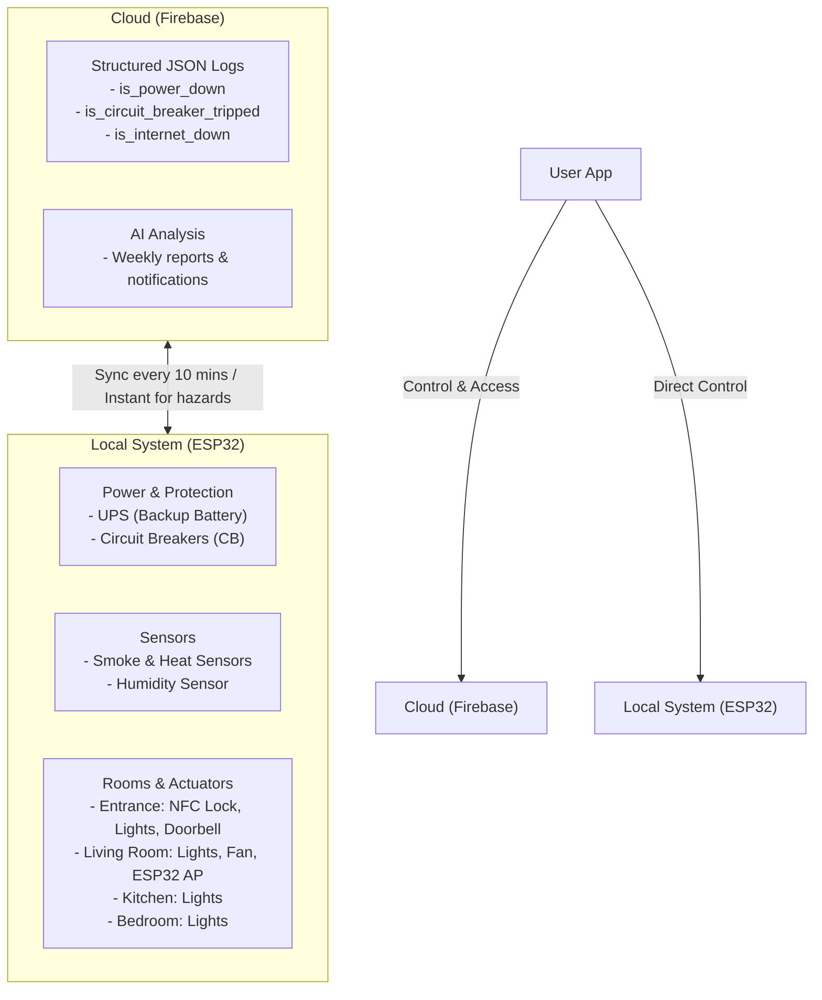

# Core System Architecture: Smart Home IoT System

## 1. System Overview
The proposed Smart Home IoT System prioritizes electrical safety, explosion prevention (short circuit / leakage mitigation), operational resilience during internet outages, and main circuit protection during power loss.

The architecture is user-centric, delegating major processing workflows to user configurations while dispatching real-time notifications during critical incidents. The overall system is divided into two main layers: **Cloud** and **Local**.

---

## 2. Structural Decomposition

### 2.1. Cloud Layer (Firebase Services)
* **Storage & Telemetry:** Stores structured JSON logs.
* **Event Logging:** Captures critical sensor events, including:
  * `is_power_down`
  * `is_circuit_breaker_tripped`
  * `is_internet_down`
* **Synchronization Strategy:** 
  * Standard local-to-cloud sync occurs every 10 minutes.
  * Hazard-detection sensors sync immediately upon trigger.
* **AI & Analytics:**
  * Analyzes data weekly to produce insights and diagnostic reports.
  * Sends real-time alerts upon anomaly detection.
  * Stores analysis results on Cloud, accessible for download via the mobile app.

### 2.2. Local Layer (Edge Processing)
* **Power & Protection:**
  * Automatic failover to UPS (power bank integrated on the main power rail) during grid outage.
  * Circuit breaker placement: One main breaker downstream of the UPS, plus individual circuit breakers at each room junction.
* **Sensors & Actuators:**
  * Environmental & hazard sensing (smoke, heat, humidity).
  * Control mechanisms for lighting and doors.
* **Core Logic:**
  * System-level logging, automation execution, and local control independent of cloud connectivity.
* **Client Interface:**
  * A mobile application serving as the unified control interface for all system capabilities.

---

## 3. Hardware & Topological Mapping

