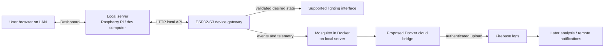

# Core System Architecture: Local-First Smart Home

## 1. Purpose and status

This document describes the planned first-release architecture and its main
operation flows. It follows the scope in [Requirements.md](Requirements.md).
The components and flows below are targets, not claims that the functions are
already implemented.

The system prioritizes user control on the local network. The ESP32-S3 is the
device gateway: it connects supported hardware to the LAN and exposes a local
API. A separate local server hosts the dashboard and supporting services.
Cloud services provide optional event storage, analysis, and remote
notifications. Loss of internet or cloud must not disable local control.
Loss of the local server makes its dashboard and hosted services unavailable,
but does not make the ESP32's device API depend on them.

## 2. First-release boundary

The first physical control target is lighting, and only after its actual
driver, wiring, and safe test procedure are confirmed. The ESP32-S3 owns local
device command validation, device state, and the LAN-facing device API. The
dashboard runs on a separate local server, such as a Raspberry Pi. A developer
computer may host it during development. In this architecture, “gateway”
means the bridge between supported devices and local services; the ESP32 does
not replace the home's router, DHCP server, or internet gateway. The home
router provides LAN connectivity unless the ESP32 is explicitly operating in
its separately specified fallback-access-point mode.

For regular use, the local server should serve the dashboard's built static
assets under a managed service. The npm development server is for development,
not the expected production deployment.

Mosquitto is the planned local MQTT broker, hosted in Docker on the local
server. The dashboard's local command path calls the ESP32 API; it does not
depend on MQTT. MQTT carries asynchronous events and telemetry. A separate
Docker-hosted service on the local server is the proposed bridge from MQTT to
Firebase, keeping cloud integration outside the real-time local command path.
Its implementation language, credentials, retry storage, and deployment
configuration remain to be selected.

Firebase is the target cloud destination. Cloud analysis and remote
notifications are later consumers of validated event data; they do not
control devices in the first release.

## 3. Component responsibilities

| Component | Responsibility | Must not become |
|---|---|---|
| ESP32-S3 firmware | Wi-Fi lifecycle, LAN-facing device API, supported device commands, event creation, local status | Dependent on Firebase, the local server, or MQTT for device control |
| Local server | Host the dashboard and Docker services; provide a stable LAN endpoint | Required for the ESP32's device-control logic |
| Browser dashboard | Served by the local server; display firmware-reported state, submit commands to the ESP32 API, show errors and stale/unavailable status | A source of authoritative device state |
| Mosquitto in Docker | Local MQTT broker on the local server for event and telemetry messages | The only path for a user device command |
| Proposed Docker cloud bridge | Consume MQTT messages, retry cloud delivery, forward acknowledged events | A prerequisite for local device control |
| Firebase | Store received event/log data; later support analysis and remote notifications | A first-release actuator controller |
| Physical device interface | Apply commands and provide whatever feedback its confirmed hardware supports | Assumed safe based only on software state |

## 4. Topology

The ESP32 may provide a fallback access point when the configured home
network is unavailable; its access policy and recovery behavior must be
specified before implementation. If the local server is not connected to
that fallback network, its hosted dashboard will not be able to reach the
ESP32. mDNS is a convenience for discovery, not a requirement for reaching
the local service.

## 5. Main operation flows

### 5.1 Boot and network availability

1. Initialize required firmware services and load non-secret configuration.
2. Attempt connection to the configured Wi-Fi network.
3. Start the device API when the selected network policy allows. If station
   connection fails, use the approved fallback-access-point policy.
4. The local server starts the dashboard, Mosquitto, and cloud bridge as
   configured. The dashboard is usable only when its host can reach the ESP32
   over the LAN.
5. Report Wi-Fi/LAN state separately from broker, internet, and Firebase
   reachability. A local IP address alone does not establish internet access.
6. Retry failed connections according to a bounded, observable policy. Network
   recovery must not restart or invalidate an in-progress local command.

Exact retry intervals, fallback timing, AP lifetime, and provisioning
security are open decisions.

### 5.2 Local status and lighting command

1. The browser loads the dashboard from the local server and fetches status
   from the ESP32's local API.
2. The user requests a desired state for a named, supported light.
3. The ESP32 validates the device and request, assigns or accepts a command
   identifier, and reports the acknowledgement level defined by the API.
4. The device interface applies the request. Report “applied” only when the
   available hardware feedback supports that claim; otherwise report the
   strongest verified acknowledgement and show actual state as unknown.
5. The dashboard reconciles status from the ESP32. It must not infer hardware
   success from a button press or HTTP request acceptance.

The ESP32 API and device-control logic do not depend on Mosquitto, Docker,
the internet, or Firebase. The normal dashboard requires the local server;
when that host is unavailable, users need another client capable of calling
the ESP32 API.

### 5.3 Event capture and local MQTT

1. The firmware creates a versioned event with a stable ID, event type,
   priority, source, occurrence time, and payload.
2. The event is recorded locally before cloud delivery is attempted. Warnings
   and critical events are surfaced on the local dashboard.
3. When Mosquitto is reachable, the firmware publishes the event/telemetry
   using the agreed MQTT topic and payload contract.
4. When the broker is unavailable, local commands continue and events remain
   available for retry. Queue capacity and overflow behavior must be
   established before relying on persistence.

MQTT delivery and Firebase persistence are separate acknowledgements. A
broker acknowledgement alone does not mean Firebase stored the event.

### 5.4 Cloud synchronization

1. The proposed Docker bridge consumes events from Mosquitto and forwards
   them to Firebase using a least-privilege credential.
2. Normal events are batched on the 10-minute cadence in
   [Requirements.md](Requirements.md). Warnings and critical events trigger
   an immediate best-effort sync attempt.
3. The bridge retries transient failures with bounded backoff and stable event
   IDs. It marks an event delivered only after the cloud acknowledges it.
4. Firebase outage, bridge outage, or internet loss leaves local control
   unaffected. Pending events are replayed after recovery without duplication.
5. Remote notification is best-effort and cannot be promised during a cloud
   or internet outage. The local dashboard is the first-release notification
   surface.

The location and durability guarantees of the bridge's retry queue, as well
as Firebase security rules, retention, quotas, and notification products,
must be decided before cloud sync is implemented.

## 6. Failure behavior

| Failure | Local dashboard/control | Event behavior |
|---|---|---|
| Internet or Firebase unavailable | Dashboard and ESP32 API remain available on LAN | Retain and retry cloud-bound events |
| Local server unavailable | Hosted dashboard, broker, and bridge are unavailable; ESP32 API/device control remain available to another LAN client | Retain events on the ESP32 within the approved queue policy |
| Mosquitto unavailable | Dashboard and ESP32 API remain available; do not route commands through MQTT | Retain events locally within the approved queue policy |
| Wi-Fi/router unavailable | Follow the approved fallback-network policy | Keep local events; cloud delivery waits for recovery |
| Unsupported device or invalid command | No actuation; return a visible error | Record diagnostic information where appropriate |
| Device feedback unavailable | Do not claim physical success | Report state as unknown or unverified |
| Queue full or persistent storage failure | Local command path remains independent | Surface the failure; apply only the approved overflow policy |

## 7. Explicitly deferred and unverified

- Fan and NFC door-lock control.
- Sensor-based power, breaker, UPS, smoke, heat, or humidity detection.
- Any mains switching, circuit protection, or hazard-mitigation claim.
- Automated AI actions and cloud-originated actuator commands.
- Final pin map, actuator circuitry, sensor selection, and electrical topology.

The board target is ESP32-S3-N16R8 per [ESP_specs.txt](ESP_specs.txt), but the
exact board revision and peripheral wiring still require confirmation. Do not
use mains-voltage hardware as an initial integration test; obtain qualified
review for electrical safety-dependent designs.

## 8. Implementation evidence

At the time this architecture is written, the local and cloud controller
sources are placeholders, and the HTTP server serves dashboard assets but
does not expose the described control API. The dashboard contains simulated
device and telemetry behavior. Treat this architecture as planned behavior
until firmware, broker, cloud, and hardware tests demonstrate each flow.
